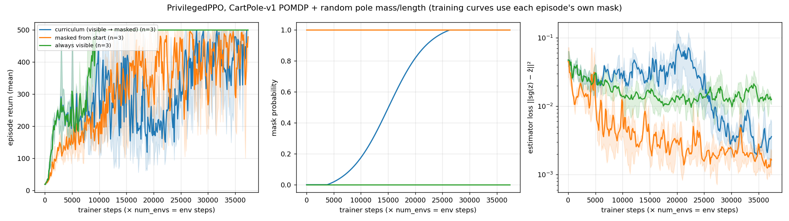
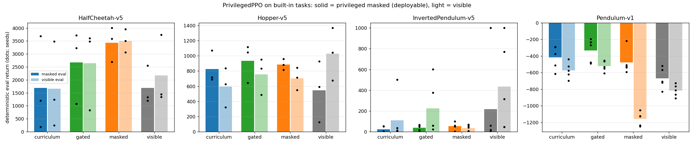
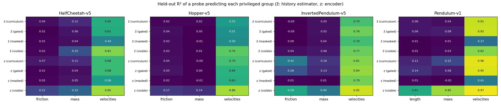
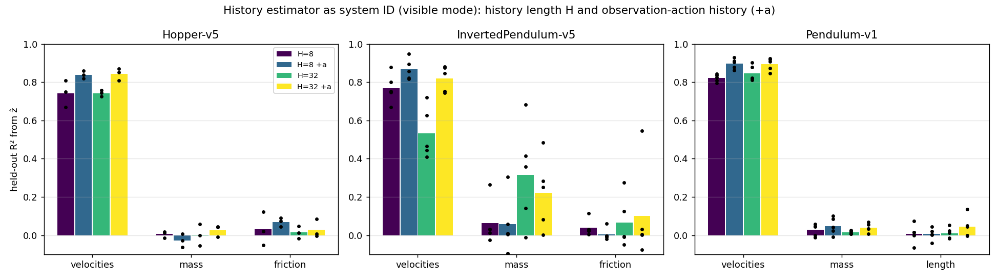

# PrivilegedPPO: privileged-observation masking curriculum

Code: `skrl/agents/torch/privileged_ppo/`, `skrl/envs/wrappers/torch/privileged_history_wrapper.py`,
example `examples/privileged_curriculum/cartpole_privileged_ppo.py`, tests `tests/agents/torch/test_privileged_ppo.py`.

The actor acts on an encoder latent `z` of the privileged values in unmasked episodes and on a history-estimator
latent `ẑ` in masked ones. The critic always sees the privileged values. `SoftmaxMaskCurriculum` ramps the
per-episode mask probability from 0 to 1. After each PPO update an extra pass minimizes
`||sg(z) − ẑ||² + 0.1·||z − sg(ẑ)||²`. Pipeline diagram: `diagrams/01_pipeline.dot`.

## Benchmark (2026-10-10)

Task: CartPole-v1 POMDP. Cart velocity and pole angular velocity are hidden, observation noise std 0.02, history
of 8 observations. Pole mass and length are randomized per episode. Privileged values: both velocities, pole mass
and pole length.

Settings: 300k env steps (8 envs), rollouts 128, 8 epochs, 4 mini-batches, lr 1e-3, 3 seeds (42, 43, 44). Curriculum:
`start=0.1, end=0.7, sharpness=10`. Evaluation: 20 deterministic episodes per seed, with the privileged values
masked (deployment setting) or visible. Max return is 500. About 5–7 min per run on the laptop, with 8 runs in parallel.

| Training mode | Eval masked (seeds 42/43/44) | Mean masked | Eval visible | Mean visible |
|---|---|---|---|---|
| curriculum (visible → masked) | 500.0 / 500.0 / 480.2 | 493.4 | 500 / 500 / 500 | 500 |
| masked from start (history only) | 500.0 / 468.6 / 500.0 | 489.5 | 500 / 500 / 500 | 500 |
| always visible | 105.2 / 142.1 / 107.3 | 118.2 | 500 / 500 / 500 | 500 |

Regenerate the plot with
`python docs/privileged_curriculum/plot.py runs/privileged_curriculum docs/privileged_curriculum/diagrams/02_sweep.png`.

What the results show:

- The curriculum works as designed: at the end of training the deployable (masked) actor reaches 480–500.
- The always-visible policy fails when masked (about 118). Its estimator is still trained by the auxiliary loss,
  but the actor never learns to act on `ẑ`, so the masking curriculum is required for deployment.
- On this task the curriculum is **not** better than training masked from the start (493 vs 490 masked, within
  seed noise). The history of 8 noisy observations is enough to recover the hidden velocities, and 300k steps
  are enough for history-only PPO. The plot shows the visible policy learning fastest (it reaches 500 at about 10k
  trainer steps). The curriculum curve stays close to it while the mask probability is low, then becomes noisy and
  drops (200–500) while the mask probability ramps and the actor switches to `ẑ`. The estimator loss of the
  curriculum runs only falls once most episodes are masked (after about 25k trainer steps).
- To show a benefit from the curriculum, a harder task is needed: one where the privileged values cannot be
  recovered cheaply from a short history (for example contact or friction parameters), or a smaller training
  budget. 3 seeds is also too few to separate 493 from 490.

Raw logs: `runs/bench_logs/priv_*.log`; TensorBoard runs: `runs/privileged_curriculum/<mode>_seed<seed>/` (not committed).

## Built-in tasks and the history estimator as system ID (2026-10-11)

Example: `examples/privileged_curriculum/gym_privileged_ppo.py`. Figures and tables:
`python docs/privileged_curriculum/plot_gym.py <runs> docs/privileged_curriculum/diagrams`. Slides:
`python docs/privileged_curriculum/build_sysid_slides.py <runs>` (also on Google Slides). Runs were on `dl`
(CPU, 16 jobs in parallel) and fetched to `runs/privileged_gym_dl/` (not committed).

Setup: the velocities are hidden (observation noise 0.01) and the dynamics are randomized per episode. Pendulum
randomizes mass and length. InvertedPendulum, HalfCheetah and Hopper scale all body masses and all sliding
frictions. Privileged values: the hidden velocities plus the dynamics scales. History H = 8. Pendulum and
InvertedPendulum get 300k steps and 5 seeds; HalfCheetah and Hopper get 1M steps and 3 seeds. Evaluation runs 16
deterministic episodes with the privileged values masked (deployable) and visible.

Modes:
- `curriculum`: time-based softmax mask schedule.
- `gated`: `RewardGatedMaskCurriculum`. Raises the mask probability by 0.1 only while the smoothed return holds its
  level (the information loss is tied to the reward staying constant), backs off by 0.1 on a drop, and has a
  deadline floor at 80 % of training.
- `masked` and `visible`: fixed throughout training.

Eval return with the privileged values masked (mean ± std over seeds):

| Task | curriculum | gated | masked | visible |
|---|---|---|---|---|
| HalfCheetah-v5 | 1692 ± 1473 | 2675 ± 1147 | **3429 ± 547** | 1691 ± 609 |
| Hopper-v5 | 826 ± 174 | **935 ± 209** | 886 ± 59 | 547 ± 329 |
| InvertedPendulum-v5 | 22 ± 24 | 39 ± 25 | 53 ± 31 | 217 ± 392 |
| Pendulum-v1 | −417 ± 127 | **−333 ± 125** | −477 ± 133 | −669 ± 113 |

The final gate probability was 1.0 on HalfCheetah and Hopper, 0.94 on Pendulum and 0.20 on InvertedPendulum.
InvertedPendulum is unstable under every mode at this budget.

What the history estimator recovers (held-out probe R² per privileged group):

- **ẑ recovers the hidden velocities** (R² 0.5–0.92) on every task and in every mode.
- **ẑ does not recover the dynamics.** R² for mass, friction and length is about 0–0.1 everywhere. The estimator
  works as a state estimator but not as a system identifier.
- **z keeps the dynamics only when they are not regularized away.** With λ = 0.1, the term λ‖z − sg(ẑ)‖² pulls z
  towards what the history can predict. As a result z keeps mass only in `visible` mode (Pendulum z-mass R² 0.85
  visible vs 0.22 curriculum).
- **With λ = 0, z keeps the dynamics but ẑ still cannot predict them.** Pendulum curriculum: z mass/length R²
  0.96/0.97, ẑ 0.08/0.08. InvertedPendulum: z 0.90/0.91, ẑ 0.09/0.01. The history itself is the bottleneck.
  λ = 0 improved the masked return for curriculum on Pendulum (−320 vs −417) and InvertedPendulum (53 vs 23),
  but not on Hopper (670 vs 826).
- **A longer history or observation-action pairs do not fix it** (ablation in `visible` mode, where z carries
  the dynamics). Appending a_{t−1} raises the velocity R² by 0.05–0.1. H = 32 lifts only InvertedPendulum mass
  (0.06 → 0.32, high variance). The masked return mostly drops with the larger inputs.

Takeaways:
- The reward-gated schedule beats the time-based one on all four tasks.
- Always-masked training is still best on HalfCheetah and InvertedPendulum. There is little to gain from the
  privileged z when ẑ cannot follow it.
- Next steps:
  - a supervised system-ID head (regress e_t directly);
  - a temporal transformer over a long (o, a) history;
  - wider dynamics ranges with less noise, to test identifiability;
  - tasks where the dynamics matter more (Isaac Lab manipulation with object mass and friction, locomotion with
    payload).
