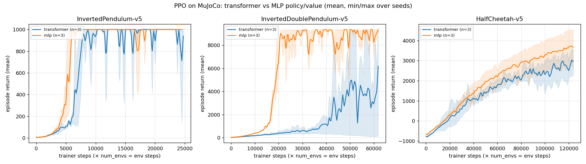

# Transformer policies for PPO on MuJoCo tasks

PPO (skrl 2.x, PyTorch) with Transformer-based policy and value models instead of MLPs, trained on
gymnasium MuJoCo tasks: `HalfCheetah-v5`, `InvertedPendulum-v5`, `InvertedDoublePendulum-v5`.

Note on the "3 inverted pendulum" task: gymnasium has no triple-pendulum environment. The closest
registered task is `InvertedDoublePendulum-v5`, which is what the example uses.

## Architecture

Code: `skrl/models/torch/transformer.py`

- `ObsTokenizer`: each observation scalar becomes one token. A shared `Linear(1, d_model)` embeds the value,
  and a learned per-dimension embedding tells the transformer which observation the token encodes.
- `TransformerEncoderTrunk`: tokens plus a learned [CLS] token, passed through `nn.TransformerEncoder`
  (`batch_first=True`, `norm_first=True`), followed by a LayerNorm. Returns the CLS embedding `[B, d_model]`.
- `TransformerGaussianPolicy(GaussianMixin, Model)`: trunk, then a linear mean head and a state-independent
  `log_std` parameter (as in the skrl pendulum example).
- `TransformerValue(DeterministicMixin, Model)`: trunk, then a linear value head.

Defaults: `d_model=64`, `n_heads=4`, `n_layers=2`, `dim_ff=128`, `dropout=0.0`. The models are not exported
from `skrl/models/torch/__init__.py`; import them from `skrl.models.torch.transformer`.

The `mlp` baseline (`--model mlp`) uses the sizes of the skrl pendulum example: two hidden layers of 64 units
with ReLU, a linear mean head, and the same `log_std` parameter.

## How to run

From the repository root:

```bash
# Transformer policy/value, InvertedPendulum, 100k environment steps, 8 envs, eval video at the end
python examples/transformer_mujoco/torch_mujoco_transformer_ppo.py --task InvertedPendulum-v5 --model transformer --video

# MLP baseline
python examples/transformer_mujoco/torch_mujoco_transformer_ppo.py --task InvertedPendulum-v5 --model mlp --video

python examples/transformer_mujoco/torch_mujoco_transformer_ppo.py --task HalfCheetah-v5 --model transformer --timesteps 1000000
```

Options: `--task {HalfCheetah-v5,InvertedPendulum-v5,InvertedDoublePendulum-v5}`, `--model {transformer,mlp}`,
`--timesteps` (total environment steps summed over envs; the trainer counts vectorized steps internally),
`--num-envs` (default 8), `--seed` (default 42), `--video`.

Outputs go to `runs/transformer_mujoco/<task>_<model>_seed<seed>/`:

- TensorBoard event file and `checkpoints/` (`agent_<step>.pt`, `best_agent.pt`), written by skrl's experiment config.
- `videos/<task>-episode-0.mp4` when `--video` is set. The eval rollout uses the deterministic mean action,
  clipped to the action space, and is recorded with gymnasium `RecordVideo` (HalfCheetah uses its `track` camera).

The models are built with `clip_actions=False`. With `clip_actions=True`, skrl's `GaussianMixin` computes `log_prob` on
the clipped action, so when the mean drifts outside the bounds (with a small std) the stored log-probs reach -1e2..-1e3,
the PPO ratio `exp(new - old)` overflows to inf, and policy and value weights become NaN in a single update. This
happened in 4 of the first 18 benchmark runs. MuJoCo already clamps the controls to `ctrlrange` on all three tasks.

Environment notes:

- Rendering needs `MUJOCO_GL`. On the development laptop `MUJOCO_GL=egl` fails with an EGLError (even with the
  Mesa vendor forced), and `osmesa` is not functional. `glfw` works with `DISPLAY` set, so the script defaults to
  `glfw`. Override with `MUJOCO_GL=<backend>` if needed.
- `RecordVideo` needs `moviepy` (1.x API; `moviepy==1.0.3` was installed into the venv).

## Benchmark results (2026-10-10)

Hardware: laptop with an RTX 4060 (8 GB), 8 runs in parallel, `OMP_NUM_THREADS=2`. Common settings: 8 envs,
`rollouts=512` per env, 10 epochs, 32 mini-batches, lr 3e-4, gamma 0.99, GAE lambda 0.95, ratio clip 0.2,
`clip_actions=False`, seeds 42, 43, 44. Budgets: InvertedPendulum 200k env steps, InvertedDoublePendulum 500k,
HalfCheetah 1M. Final return is the mean of the last 5 logged `Reward / Total reward (mean)` values per seed
(stochastic policy), then mean ± std over seeds.

| Task | Model | Env steps | Final return (mean ± std, 3 seeds) | Per seed (42 / 43 / 44) | Eval seed 42 (deterministic, video) |
|---|---|---|---|---|---|
| InvertedPendulum-v5 | transformer | 200k | 872 ± 181 | 1000 / 1000 / 617 | 1000 |
| InvertedPendulum-v5 | mlp | 200k | 1000 ± 0 | 1000 / 1000 / 1000 | 1000 |
| InvertedDoublePendulum-v5 | transformer | 500k | 4271 ± 2936 | 121 / 6216 / 6475 | 118 |
| InvertedDoublePendulum-v5 | mlp | 500k | 8731 ± 429 | 9298 / 8259 / 8636 | 9360 |
| HalfCheetah-v5 | transformer | 1M | 2729 ± 504 | 2164 / 2636 / 3387 | 2877 |
| HalfCheetah-v5 | mlp | 1M | 3698 ± 712 | 2791 / 3771 / 4530 | 3370 |



Regenerate the table and plot with
`python examples/transformer_mujoco/plot_benchmark.py runs/transformer_mujoco docs/belief_ppo/diagrams/06_transformer_benchmark.png`.

What the results show:

- At these budgets and default sizes, the MLP is better or equal on all three tasks and learns faster. On
  InvertedDoublePendulum the MLP solves the task (about 9.3k) after about 20k trainer steps; two transformer seeds
  reach about 9.3k only after 40k+ trainer steps and are unstable, and seed 42 never learns (about 120).
- On HalfCheetah the transformer tracks the MLP for the first 40k trainer steps and then falls about 1k behind.
  The seed ranges overlap (transformer 2.2k–3.4k, MLP 2.8k–4.5k), so 3 seeds do not separate them cleanly.
- Wall time (8 runs sharing the laptop, so contention-dependent): InvertedPendulum 8 vs 6 min, InvertedDoublePendulum
  20–21 vs 11–17 min, HalfCheetah 27–39 vs 16–32 min (transformer vs MLP), about 1.2–1.8× per run.
- One token per observation scalar with no history gives the transformer no information the MLP lacks. On fully
  observed MuJoCo tasks, the benchmark measures only optimization difficulty, where the MLP wins. A transformer is
  more likely to help with history tokens on partially observed tasks (see the privileged-curriculum work).
- The HalfCheetah seed-42 videos were re-recorded from `agent_125000.pt` with the tracking camera, which is why their
  eval returns (2877 / 3370) differ from the in-run evals with the old static camera (3075 / 3406). The cheetah
  runs off the edge of the finite floor plane after a few seconds, so the background turns grey.

Videos (under `runs/`, not committed): `runs/transformer_mujoco/<task>_<model>_seed42/videos/<task>-episode-0.mp4`.
Raw logs: `runs/bench_logs/tf_*.log`. Runs from before the `clip_actions` fix are kept in
`runs/transformer_mujoco_clipnan_20261010/`.

## Not done / open items

- No hyperparameter tuning (the transformer uses the MLP's PPO settings, including lr 3e-4) and only 3 seeds.
- HalfCheetah has not converged at 1M steps for either model.
- No history/memory tokens: the tokenizer is one token per current observation dimension.
- The Transformer models are not wired into skrl's model instantiators or the model registry; they are used
  through the explicit classes in `skrl/models/torch/transformer.py`.
- No triple-pendulum task (see the note at the top).
